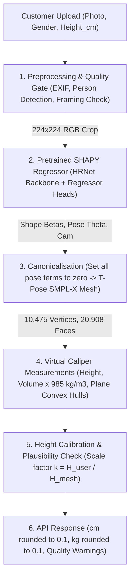

# Image-to-Measurements Module Architecture

This document provides the system architecture, mathematical formulas, and data flow for the **Sui Dhaga Image-to-Measurements** module.

---

## 1. Pipeline Overview

---

## 2. Methodology & Formulation

The core pipeline directly implements the methodology from:
> **"Accurate 3D Body Shape Regression using Metric and Semantic Attributes"**  
> *Vasileios Choutas, Lea Müller, Chun-Hao P. Huang, Siyu Tang, Dimitris Tzionas, Michael J. Black* (CVPR 2022 / arXiv:2206.07036)

### Step 1: Image $\rightarrow$ $(\beta, \theta, \text{Cam})$
- Input: Single full-body RGB customer photo.
- The pretrained SHAPY regressor predicts:
  - Shape coefficients $\beta \in \mathbb{R}^{10}$
  - Body pose parameters $\theta \in \mathbb{R}^{63}$ (21 joints $\times$ 3 Rodrigues rotations)
  - Global orientation $\in \mathbb{R}^3$
  - Weak perspective camera parameters $[s, t_x, t_y]$.

### Step 2: Canonicalisation (Zero-Pose T-Pose)
- In the original photo, the subject may be standing with natural body posture, angled limbs, or uneven feet.
- To measure true anthropometric circumferences without posture distortion:
  - Retain predicted shape coefficients $\beta$.
  - Force **all pose parameters to zero**:
    $$\text{global\_orient} = 0, \quad \theta_{\text{body}} = 0, \quad \theta_{\text{jaw}} = 0, \quad \theta_{\text{hands}} = 0, \quad \text{expression} = 0$$
  - Regenerate the 3D surface mesh using the gendered SMPL-X model (`SMPLX_FEMALE.npz`, `SMPLX_MALE.npz`, or `SMPLX_NEUTRAL.npz`).
  - Output: Canonical T-pose mesh consisting of $N = 10,475$ vertices $V \in \mathbb{R}^{10475 \times 3}$ and $M = 20,908$ triangular faces $F \in \mathbb{R}^{20908 \times 3}$.

### Step 3: Virtual Measurements (Virtual Caliper / Wuhrer et al.)
1. **Height (Stature)**:
   Vertical Euclidean distance along the $Y$-axis between the `HeadTop` landmark and `HeelLeft` ground contact landmark:
   $$H_{\text{mesh}} = | Y_{\text{HeadTop}} - Y_{\text{HeelLeft}} |$$
   Landmark coordinates are determined by the barycentric coordinates documented in `mesh-mesh-intersection/data/smplx_measurements.yaml`:
   - `HeadTop`: Face 2581, barycentric $[0.8277, 0.1422, 0.0300]$
   - `HeelLeft`: Face 15605, barycentric $[0.0, 1.0, 0.0]$

2. **Weight (Estimated Mass)**:
   Calculated by summing the signed tetrahedra volumes of all $M$ watertight triangular faces from the origin (divergence theorem) multiplied by average human body density ($985 \text{ kg/m}^3$):
   $$\text{Volume} = \frac{1}{6} \left| \sum_{i=1}^{M} \det \begin{bmatrix} v_{i,0} & v_{i,1} & v_{i,2} \end{bmatrix} \right|$$
   $$\text{Weight} = \text{Volume} \times 985 \text{ kg/m}^3$$

3. **Circumferences (Chest, Waist, Hips)**:
   - For each measurement, a horizontal cutting plane with normal $\mathbf{n} = (0, 1, 0)$ is placed at landmark height $Y$:
     - **Chest**: Landmark `NippleRight` (Face 18402, $bc=[0, 0, 1]$)
     - **Waist**: Landmark `BellyButton` (Face 19229, $bc=[0, 1, 0]$)
     - **Hips**: Landmark `Crotch` (Face 6194, $bc=[0, 0, 1]$)
   - The triangular surface mesh is intersected with the plane $y = Y_{\text{landmark}}$.
   - The 2D intersection points $(X, Z)$ are projected onto the plane.
   - The 2D convex hull of these intersection points is computed using Quickhull (`scipy.spatial.ConvexHull`).
   - The circumference is defined as the perimeter of this 2D convex hull.

---

## 3. Sui Dhaga Tailoring Extensions (NOT in SHAPY Paper)

The following additions are proprietary platform extensions specifically designed for tailoring workflows:

1. **Scale-to-Height Calibration**:
   Monocular 2D images suffer from fundamental scale ambiguity (a tall person far away looks identical to a shorter person closer to the camera). We resolve this by having the user enter their known height $H_{\text{user}}$ in cm:
   $$k = \frac{H_{\text{user}} / 100}{H_{\text{mesh}}}$$
   - Sanity check: If $k < 0.70$ or $k > 1.40$, the request is rejected with `SCALE_IMPLAUSIBLE`.
   - Linear measurements (circumferences, lengths) scale by $k$: $M' = k \cdot M$.
   - Volume scales cubically by $k^3$: $\text{Vol}' = k^3 \cdot \text{Vol}$.

2. **Additional Tailoring Measurements**:
   - **Shoulder Width (Bi-acromial)**: Euclidean distance between `ShoulderLeft` (Face 3865) and `ShoulderRight` (Face 18186).
   - **Sleeve Length**: Sum of Euclidean segments `ShoulderLeft` $\rightarrow$ `ElbowLeft` $\rightarrow$ `WristLeft`.
   - **Inseam**: Vertical distance from `Crotch` landmark down to `HeelLeft`.
   - **Neck Circumference**: 2D convex hull perimeter of mesh intersection with horizontal plane at `NeckBase` (Face 18412).
   - **Thigh Circumference**: 2D convex hull perimeter of left leg intersection $5\text{ cm}$ below crotch level ($X > 0.01$).

---

## 4. Known Limitations & Failure Modes

1. **Single-Photo Expected Error**:
   As documented in the SHAPY paper's Human Bodies in the Wild (HBW) evaluation, the expected Mean Absolute Error (MAE) from a single in-the-wild photo is approximately:
   - Chest: $\approx 65 \text{ mm}$ ($6.5 \text{ cm}$)
   - Waist: $\approx 69 \text{ mm}$ ($6.9 \text{ cm}$)
   - Hips: $\approx 57 \text{ mm}$ ($5.7 \text{ cm}$)
   All measurements must be presented to tailors with the disclaimer: *"Estimates from a single photo; expected error is several cm. Tailor must confirm before cutting."*

2. **Clothing Distortion**:
   Loose, oversized, or layered garments (coats, oversized shirts, flowing dresses) distort the visual silhouette, leading to potential overestimation of waist and chest circumferences. The quality gate issues an advisory warning if wide silhouettes are detected.

3. **High-BMI / Extreme Muscular Bodies**:
   Statistical shape spaces (SMPL-X $\beta$ PCA components) have lower sample density at extreme BMI values. Discrepancies between estimated weight and actual weight $> 25\%$ trigger quality gate warnings.

4. **Licensing**:
   Pretrained weights for SHAPY and SMPL-X are strictly licensed for non-commercial scientific research. Commercial tailor order processing requires obtaining a separate commercial license from Max-Planck-Innovation (`ps-licensing@tue.mpg.de`).
